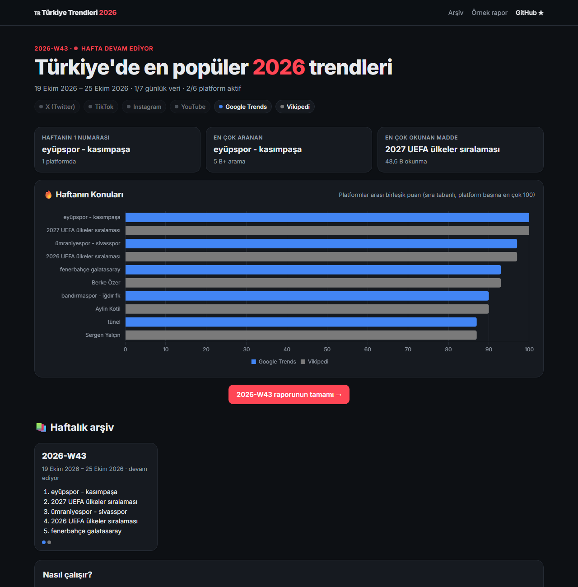
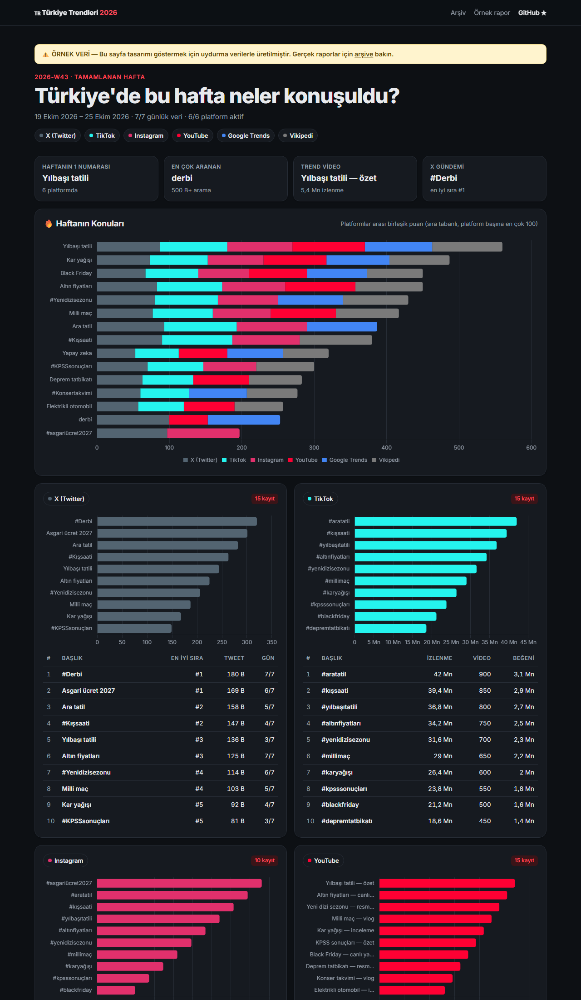
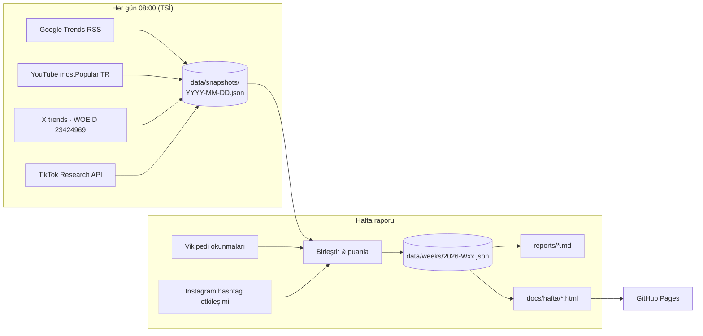

<div align="center">

# Türkiye'de En Popüler 2026 Trendleri

**X, TikTok, Instagram, YouTube, Google Trends ve Vikipedi'den Türkiye gündemini toplayan, her hafta grafikli rapor yayınlayan açık kaynak bot.**

[](https://github.com/aytcode/turkiye-trendleri/actions/workflows/trendler.yml)
[](LICENSE)
[](https://github.com/aytcode/turkiye-trendleri/stargazers)

[Canlı site](https://aytcode.github.io/turkiye-trendleri/) · [Son rapor](#son-rapor) · [Örnek rapor](https://aytcode.github.io/turkiye-trendleri/ornek.html) · [API anahtarları](#api-anahtarları)

<picture>
  <source media="(prefers-color-scheme: dark)" srcset="docs/assets/anasayfa-koyu.png">
  
</picture>

</div>

## Neler yapar?

- **6 kaynak, tek rapor** — Google Trends, Vikipedi, YouTube, X (Twitter), TikTok ve Instagram.
- **"Haftanın Konuları"** — aynı konu farklı platformlarda eşleştirilir (`#KışSaati` = `kış saati`) ve platformlar arası tek bir puanla sıralanır.
- **Grafikli HTML + Markdown** — her hafta [chart.js](https://www.chartjs.org/) grafikleriyle bir sayfa ve GitHub'da okunabilen bir `.md` raporu.
- **Tamamen otomatik** — GitHub Actions her gün veri toplar, her hafta raporu kesinleştirir ve GitHub Pages'e yayınlar.
- **Anahtar yoksa çökmez** — API anahtarı eklenmemiş platformlar raporda "atlandı" olarak görünür; Google Trends ve Vikipedi **anahtarsız** çalışır.
- **Sıfır bağımlılık** — yalnızca Node.js ≥ 20 (yerleşik `fetch`). `npm install` bile gerekmez.
- **Açık veri** — her haftanın ham verisi JSON olarak: [`docs/data/weeks.json`](https://aytcode.github.io/turkiye-trendleri/data/weeks.json).

## Son rapor

<!-- SON-RAPOR:BASLA -->
**2026-W44** (2026-10-26 → 2026-11-01) · hafta devam ediyor — [grafikli rapor](https://aytcode.github.io/turkiye-trendleri/hafta/2026-W44.html) · [Markdown](reports/2026-W44.md)

| # | Konu | Platform sayısı |
|---:|---|---:|
| 1 | fırtına | 1 |
| 2 | 2026 İsrail yasama seçimi | 1 |
| 3 | bursaspor (futbol takımı) | 1 |
| 4 | 29 Ekim Cumhuriyet Bayramı | 1 |
| 5 | öğle ezanı | 1 |
| 6 | Mustafa Sarıgül | 1 |
| 7 | cuma namazı saat kaçta | 1 |
| 8 | Burhaneddin Kirmânî | 1 |
| 9 | selçuk şahin | 1 |
| 10 | XHamster | 1 |
<!-- SON-RAPOR:BITIR -->

> Bu tablo bot tarafından her gün otomatik güncellenir. Tüm haftalar: [arşiv](https://aytcode.github.io/turkiye-trendleri/#arsiv) · [`reports/`](reports/)

## Ekran görüntüsü

<div align="center">

<br><sub>Tüm platformlar etkinken bir haftalık rapor — <a href="https://aytcode.github.io/turkiye-trendleri/ornek.html">örnek sayfa</a> (uydurma örnek veri)</sub>
</div>

## Nasıl çalışır?



1. **Günlük anlık görüntü.** Google Trends akışı yalnızca son ~24 saati gösterdiği için bot her gün çalışır ve sonuçları `data/snapshots/` altına kaydeder.
2. **Haftalık birleştirme.** ISO haftasının (Pazartesi–Pazar) görüntüleri toplanır. Pazartesi çalışması geçen haftayı **kesinleştirir**; içinde bulunulan hafta sitede "devam ediyor" olarak görünür.
3. **Platformlar arası puan.** Her platformun ilk 30 konusu sırasına göre 100'den 3'e kadar puan alır; aynı konu birden çok platformda varsa puanlar toplanır. Ölçekleri çok farklı olan platformları (izlenme vs. arama) adil karşılaştırmak için ham sayılar yerine sıra kullanılır.
4. **Yayın.** Markdown, HTML ve JSON üretilir, depoya commit'lenir ve `docs/` GitHub Pages'e yüklenir.

## API anahtarları

Tüm anahtarlar **isteğe bağlıdır**. Depoda **Settings → Secrets and variables → Actions → New repository secret** yolundan ekleyin:

| Platform | Secret(lar) | Erişim | Notlar |
|---|---|---|---|
| Google Trends | — | Ücretsiz, anahtarsız | Resmi RSS: `trends.google.com/trending/rss?geo=TR` |
| Vikipedi | — | Ücretsiz, anahtarsız | Wikimedia Pageviews API, `tr.wikipedia` |
| YouTube | `YOUTUBE_API_KEY` | **Ücretsiz** (10.000 birim/gün) | [Google Cloud Console](https://console.cloud.google.com/apis/library/youtube.googleapis.com) → YouTube Data API v3 → Kimlik bilgileri → API anahtarı. Günde ~2 birim harcar. |
| X (Twitter) | `X_BEARER_TOKEN` | Ücretli/sınırlı katman | [developer.x.com](https://developer.x.com/) — `GET /2/trends/by/woeid/:id` uç noktasına erişimi olan bir uygulamanın Bearer Token'ı. |
| TikTok | `TIKTOK_CLIENT_KEY`, `TIKTOK_CLIENT_SECRET` | Başvuru ile (Research API) | [TikTok Research API](https://developers.tiktok.com/products/research-api/) onaylı uygulamanın client key/secret'ı. |
| Instagram | `IG_USER_ID`, `IG_ACCESS_TOKEN` | Ücretsiz, Business/Creator hesap | [Instagram Graph API — Hashtag Search](https://developers.facebook.com/docs/instagram-platform/instagram-graph-api/reference/ig-hashtag-search). Uzun ömürlü erişim jetonu + IG kullanıcı kimliği. 7 günde en fazla 30 hashtag sınırı nedeniyle haftada 12 hashtag sorgulanır. |

> En hızlı kazanım: yalnızca `YOUTUBE_API_KEY` ekleyin — ücretsizdir ve 5 dakikada alınır.

> Instagram herkese açık bir "trend listesi" sunmaz. Bot, diğer platformlarda öne çıkan konuları hashtag olarak arar ve son 7 günün popüler gönderilerindeki beğeni + yorum toplamını ölçer.

## Yerelde çalıştırma

```bash
git clone https://github.com/aytcode/turkiye-trendleri.git
cd turkiye-trendleri
node src/cli.mjs run          # bugünü topla + haftalık raporu üret + siteyi oluştur
node scripts/serve.mjs        # http://localhost:4173 adresinde önizle
```

Anahtar kullanmak için ortam değişkenlerini ayarlayın (bkz. [`.env.example`](.env.example)):

```bash
YOUTUBE_API_KEY=xxx node src/cli.mjs run
```

| Komut | Ne yapar? |
|---|---|
| `node src/cli.mjs collect` | Bugünün anlık görüntüsünü `data/snapshots/` altına yazar |
| `node src/cli.mjs report --week 2026-W43` | Belirtilen haftanın raporunu üretir |
| `node src/cli.mjs build` | `docs/`, `reports/` ve README özetini yeniden üretir |
| `node src/cli.mjs run` | Günlük iş akışının tamamı |
| `node src/cli.mjs demo` | Uydurma örnek veriyle `docs/ornek.html` üretir |
| `npm test` | Birim testleri |

## Kendi ülken / kendi sayfan için

1. Depoyu **fork**'la.
2. **Settings → Pages → Source: GitHub Actions** seç.
3. İstediğin secret'ları ekle ve **Actions → Trend raporu → Run workflow** ile ilk çalıştırmayı başlat.

Başka bir ülke için `geo=TR`, `regionCode=TR`, WOEID (`23424969`), `region_code` ve `tr.wikipedia` değerlerini `src/sources/` altında değiştirmen yeterli.

## Proje yapısı

```
src/
  cli.mjs              komutlar (collect / report / build / run / demo)
  model.mjs            haftalık model + platformlar arası puanlama
  sources/             her platform için bir modül (collect + aggregate)
  render/              Markdown ve HTML üreticileri
data/snapshots/        günlük ham anlık görüntüler
data/weeks/            haftalık rapor modelleri (JSON)
reports/               haftalık Markdown raporları
docs/                  GitHub Pages sitesi (index, hafta/*, data/*, assets/)
.github/workflows/     zamanlanmış GitHub Actions iş akışı
```

## Yol haritası

- [ ] Haftadan haftaya yükselen/düşen konular (📈/📉)
- [ ] Şehir bazlı Google Trends
- [ ] RSS akışı ve Telegram/Discord bildirimi
- [ ] Spotify Türkiye Top 50

## Katkı

Hata bildirimi, yeni kaynak veya tasarım önerileri için [issue](https://github.com/aytcode/turkiye-trendleri/issues) açabilir ya da PR gönderebilirsin. Yeni bir kaynak eklemek için `src/sources/` altındaki modüllerden birini örnek alman yeterli.

Proje işine yaradıysa yıldız vermeyi unutma — daha çok kişinin görmesini sağlar!

## Lisans ve sorumluluk reddi

[MIT](LICENSE). Veriler ilgili platformların resmi API'lerinden ve herkese açık akışlarından alınır; her platformun kullanım koşulları geçerlidir. X, TikTok, Instagram, YouTube, Google ve Wikipedia ilgili sahiplerinin ticari markalarıdır; bu proje onlarla bağlantılı değildir. "Örnek rapor" sayfası yalnızca tasarımı göstermek için uydurulmuş veriler içerir.

## VirusTotal

[](https://www.virustotal.com/gui/url/c5b61512ab5d97fd5b964053e5d75146ccfd8e6b53edd45478d853fd5fb1c2e7)

Dosyalar [VirusTotal](https://www.virustotal.com) ile tarandı; hiçbir antivirüs motoru tehdit bulmadı.

| Taranan | Sonuç | Tarih | Rapor |
|---|---|---|---|
| Kaynak kod (`main.zip`) | **0/93** temiz | 24.10.2026 | [Raporu gör](https://www.virustotal.com/gui/url/c5b61512ab5d97fd5b964053e5d75146ccfd8e6b53edd45478d853fd5fb1c2e7) |
